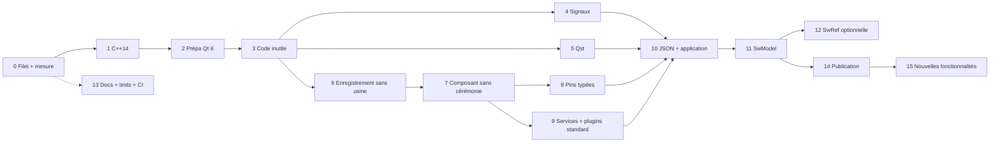

# StreamWork : plan d'évolution

Ce document fusionne `PlanModernisation.md` (dette technique) et `PlanConvergenceNebula.md` (ergonomie pour l'auteur de plugins). Il décrit toutes les étapes, dans l'ordre où elles sont réalisées.

## 1. Objectifs

**Technique**

- Rester en **C++14** et moderniser le code dans cette limite.
- Supprimer les classes inutiles.
- Passer à un format **JSON**, en gardant la lecture des anciens fichiers XML (stream et conf).
- Supprimer **LibIndeSig** (« libsig ») et la plupart des dépendances **Qst**.
- Préparer une migration facile vers **Qt 6** (non planifiée à ce jour).

**Ergonomie** (reprendre de Nebula les idées, pas le code)

- Moins de code à écrire pour un plugin, un composant ou une application.
- Une seule source de vérité par information (nom, description, version, propriétés).
- Plus simple à maintenir : CMake en quelques lignes, documentation pas à pas, tests par classe.
- Compatible : le code source des plugins existants continue de compiler pendant la période de dépréciation.

**Ensuite** : nouvelles fonctionnalités.

## 2. Décisions

| Sujet | Décision |
|---|---|
| Orientation | **StreamWork est modernisé.** Nebula n'est ni une base ni une dépendance : ses idées seulement. |
| Qt 5.9.6 et MSVC 2015 | Abandonnés. Cibles : MSVC 2022 + Qt 5.15, GCC 11.3 + Qt 5.15. |
| Standard C++ | **C++14**. C++17 et C++20 sont exclus. Qt 6 exige C++17 : la migration effective vers Qt 6 reste bloquée tant que cette contrainte existe. Le plan ne fait que la préparer. Nebula utilise des concepts C++20 : on garde l'idée avec `static_assert` + `std::is_base_of` / SFINAE. |
| Outil de build | **cstoolkit est conservé** et mis à jour (plus complet que le `CMakeUtils` de Nebula). |
| Noms | `SW_REGISTER_COMPONENT`, `SW_REGISTER_COMPONENT_AS`, `SW_REGISTER_DATA`, `sw_add_plugin`, `SwPlugin<P>`, `SwApplication`. |
| Vocabulaire | Celui de StreamWork est conservé (Stream, Pin, Component, Service). Pas de Galaxy ni d'Astre. |
| Composants standard (journal, historique) | **Plugins livrés par défaut** avec le framework. |
| Composition réutilisable | `SwModel` / `SwModelHost` est l'équivalent de la galaxy : on l'aligne, on ne crée pas de nouvelle notion. |
| Version | Le nouveau framework est livré en **version majeure**. |
| Plugins `.swdl` tiers | Recompilation nécessaire (l'ABI change). Leur **code source** reste compatible pendant la dépréciation. |
| Signaux | Qt natif pour les classes `QObject`. Pour les autres : observateurs ou `SwSignal` (hors Qt). |
| Fichiers XML | Toujours ouverts. Conversion vers JSON proposée à l'utilisateur. |

À trancher : contenu des plugins standard au premier livrable (journal seul, ou journal + historique).

## 3. État actuel (audit)

- Aucun standard C++ n'est fixé dans CMake. Il y a 15 modules et environ 600 fichiers. Il n'y a aucun test unitaire.
- **LibIndeSig** : `SwCore/include/Tools/Signal/LibIndeSig.h`.
  - Il se compose de `iSignal0..7` avec `iconnect` et `idisconnect`.
  - Il est inclus dans environ 35 fichiers, avec environ 190 appels.
  - `SwRef` en dépend (`getOnDestroySignal`).
- **Qst** : `QsException` est lié partout, `QsCore` et `QsGui` dans 4 modules, `QsLog` dans 2 (`main.cpp`, `SwPropertyPersistentToolbox.cpp`).
  - Beaucoup de liens CMake sont probablement inutiles.
  - Des équivalents locaux existent : `SwException.h` et `Tools/Log/*`.
- **Persistance** : tout est en XML (`QDomDocument`, `QXmlStreamWriter/Reader`).

| Fichier | Classes principales |
|---|---|
| Stream (`.xml`) | `SwSaver_Class`, `SwLoader_Class`, `StreamControler` |
| Graphique | `GraphicsLoaderV1` |
| Conf (`.conf`) | `SwServiceSaveConfiguration`, `_SwManagedConfigurationsList` |
| Enregistrement | `Record.xml` (`_RecordManager`, `_TimeLine`) |
| Disposition GUI | `dockParameters.xml` |
| Réglages | `QSettings` (`.ini`) |

- **Dette** :
  - 171 `NULL` ;
  - 83 `new`/`delete` ;
  - `qSort`, `QRegExp`, `foreach` ;
  - 6 singletons ;
  - `SwRef` / `SwRefPtr` (équivalent maison de `shared_ptr`) ;
  - macros `SIGNAL()`/`SLOT()` (26 occurrences) ;
  - `#pragma` MSVC.
- **Cérémonie pour l'auteur** : voir section 4.

## 4. Ergonomie : écart avec Nebula et cible

### 4.1 Écarts

| Sujet | StreamWork aujourd'hui | Cible StreamWork |
|---|---|---|
| Enregistrer un composant | Classe usine par plugin (`_XxxPluginFactory_Class`, 2 fichiers). Le nom est écrit 3 fois : `RegisterComponent("X", "desc")`, `SW_PUBLISH_COMPONENT("X", X)` (chaîne de `if` dans `CreateInstanceOf`) et l'`#include`. À chaque ajout, on modifie l'usine. `SwGui` a une cinquantaine de lignes `RegisterComponent`. | `SW_REGISTER_COMPONENT(Plugin, Composant);` dans le `.cpp` du composant. L'usine disparaît. |
| Classe du plugin | Écrite à la main : `Initialize`, `Liberate`, `GetPluginVersion`, `GetPluginCompilationDate`, `CreateInstanceOf` ×2, `CreateIconOf`, export `GetPluginInterface`. | Générée par `sw_add_plugin()` à partir d'un gabarit. |
| Métadonnées du plugin | Lues en chargeant la DLL. | JSON embarqué par `Q_PLUGIN_METADATA` (disponible en Qt 5.15) : id, nom, version, version du cœur, version de l'API. Lu au scan sans charger la DLL. |
| Description / catégorie d'un composant | Chaîne passée à `RegisterComponent`, loin de la classe. | `Q_CLASSINFO("description", …)` et `Q_CLASSINFO("category", …)` sur la classe. |
| CMake d'un plugin | `cstoolkit_add_target(… SHARED NAMESPACE Streamwork EXTENSION swdl RECURSIVE RECURSIVE_INCLUDE PUBLIC_LINK_LIBRARIES …)` avec 10 à 15 bibliothèques (ex. `SwGui`). | `sw_add_plugin(NAME … VERSION …)` avec liens par défaut (SwCore, SwFoundation, Qt5::Core, Qt5::Widgets). |
| Création de l'objet | Appel manuel de `initializeComponent()` puis `createPropertiesForThisObject()`. | `SwPlugin::Instance<T>` crée l'objet et appelle l'initialisation. Les `Q_PROPERTY` sont exposées d'office. |
| Interfaces entre composants | `provideInterface<T>(nom, ptr)` existe. Consommation par observateur. | `consumeInterface<T>(nom, membre, Mandatory\|Optional, onAvailable, onUnavailable)` : le membre est écrit par le cœur. |
| Données des pins | `SwData_Class` : UUID + `GetType` + `GetTypeId` + `InternalRead` + `InternalWrite` + `CreateInstance` + `RegisterData` dans l'usine. | Pins typées : `addInput<T>(nom, callback)` / `addOutput<T>(nom)`. Plus de `dynamic_cast` ni d'UUID à la main. |
| Services | Singletons enregistrés via `SW_APP->RegisterService`, accédés par `SwServiceManager_Helper<I>`. Un plugin usine par service. | Un service est un composant qui fournit une interface. Plugins standard livrés par défaut. |
| Composition | `SwModel` (`_SwModel_Class`, expose `ISwSubStream`) et `SwModelHost` (`_SwModelHost_Class`, expose les entités `_SwModelExported*`). Modèles enregistrés **dynamiquement** par l'usine (`modelAdded`, `RereadPluginContent`) et lus en XML. | Chargement testable, JSON, entités exposées déclaratives. |
| Application | `main.cpp` d'environ 60 lignes (`SW_APP`, chemins, `Launch`, `try/catch`). | `SwApplication` : options de ligne de commande et stream gérés. |
| Fichier stream | XML. | JSON versionné. |
| Tests | Aucun. | Un exécutable Qt Test par classe, `ctest`, couverture de 80 % sur le nouveau code. |
| Documentation | 7 fichiers `.md` à la racine qui se recoupent (`INDEX_COMPLET`, `RESUME_MISE_A_JOUR`, `QUICKSTART`…). | `README` de référence, wiki pas à pas, glossaire, `CONVENTIONS.md`, `CHANGELOG.md`, carte du code. |

### 4.2 Ce que l'auteur écrit : avant

Usine du plugin (2 fichiers) :

```cpp
// _XxxPluginFactory_Class.cpp
void _XxxPluginFactory_Class::Initialize() {
    RegisterComponent("SwConfPushButton", "Declenche la sauvegarde de la conf");
}
SwComponent_Class* _XxxPluginFactory_Class::CreateInstanceOf(QString name) {
    SW_PUBLISH_COMPONENT("SwConfPushButton", SwConfPushButton);
    return NULL;
}
SwPluginFactory_Class* GetPluginInterface() { return new _XxxPluginFactory_Class(); }
```

Composant :

```cpp
void SwConfPushButton::initializeComponent() {
    createPropertiesForThisObject();
    createPropertiesForQObject(_pb, "QPushButton");
    provideInterface<QWidget>("Widget", _pb);
}
```

### 4.3 Ce que l'auteur écrit : cible

```cpp
// ConfPushButton.h
class ConfPushButton : public SwComponent {
    Q_OBJECT
    Q_CLASSINFO("description", "Declenche la sauvegarde de la conf")
    Q_CLASSINFO("category", "Configuration")
    Q_PROPERTY(QString confName READ confName WRITE setConfName NOTIFY confNameChanged)
public:
    ConfPushButton();
    // accesseurs et signal
private:
    QPushButton m_button;
    QString m_confName;
};

// ConfPushButton.cpp
SW_REGISTER_COMPONENT(ConfPlugin, ConfPushButton);

ConfPushButton::ConfPushButton() {
    provideInterface<QWidget>("widget", &m_button);
    addPropertiesForQObject(&m_button, "QPushButton");
}
```

```cmake
sw_add_plugin(
    NAME ConfPlugin
    DESCRIPTION "Composants de configuration"
    VERSION 1.0.0
)
```

```cpp
int main(int argc, char* argv[]) {
    StreamWork::SwApplication app(argc, argv);
    return app.run();   // options, chemins de plugins, stream, erreurs
}
```

### 4.4 Objectifs chiffrés

| Mesure | Aujourd'hui | Cible |
|---|---|---|
| Fichiers à écrire pour un plugin d'un composant | 6 (usine ×2, composant ×2, CMake, export) | 3 (composant ×2, CMake) |
| Fichiers modifiés pour ajouter un composant à un plugin existant | 3 à 4 | 2 |
| Lignes de CMake d'un plugin | 10 à 15 | 3 à 5 |
| Noms de composant à saisir | 3 | 0 (le nom de la classe) |
| Lignes d'un `main.cpp` | environ 60 | environ 5 |

Ces valeurs sont des estimations : la phase 0 les mesure.

### 4.5 Principes

1. **Une seule source de vérité** : nom = nom de la classe, description et catégorie = `Q_CLASSINFO`, version = CMake.
2. **Le framework fait le câblage** : enregistrement, propriétés, cycle de vie, liaison des interfaces.
3. **Un contrat par composant** : interfaces et pins déclarées au constructeur, typées.
4. **Pas de singleton pour les fonctions de base** : un service est un composant qui fournit une interface.
5. **Compatibilité d'abord** : l'ancienne API reste active tant que la période de dépréciation n'est pas terminée.
6. **Chaque étape est testée** avant d'être généralisée.

## 5. Règles de commit

- Chaque commit compile sur toutes les plateformes cibles et passe les tests.
- On ne mélange jamais changement mécanique (renommage, `nullptr`) et changement fonctionnel.
- Les commits mécaniques sont faits par module. Le message indique l'outil utilisé (clang-tidy ou script).
- Une classe supprimée, ou un groupe cohérent, par commit.
- Les fichiers de référence de la phase 0 prouvent que les anciens fichiers se chargent toujours.
- Chaque phase peut être livrée en version mineure tant qu'elle ne fait qu'ajouter (ancienne API active).

## 6. Phases

### Phase 0 : filet de sécurité et mesure

1. `chore` : `.editorconfig`, `.clang-format`, `.gitattributes`. Le reformatage est isolé et ajouté à `.git-blame-ignore-revs`.
2. `test` : infrastructure `ctest` (Catch2 ou GoogleTest), dossier `tests/`, étape Jenkins.
3. `test` : fichiers de référence. On capture des streams, `.conf` et `Record.xml` produits par la version actuelle. Les tests font charger, sauver, recharger et comparer.
4. `test` : test de chargement des plugins. Il scanne un dossier, charge chaque `.swdl`, liste ses composants (noms et descriptions). Il sert de filet pour toutes les phases suivantes.
5. `ci` : retrait de MSVC 2015 et Qt 5.9.6.
6. `ci` : `QT_DISABLE_DEPRECATED_BEFORE=0x060000`, en avertissement seulement. On obtient la liste des API qui disparaissent en Qt 6.
7. Mesurer l'état initial du tableau 4.4 (fichiers et lignes d'un plugin minimal, nombre de lignes `RegisterComponent`, `main.cpp`).
8. Choisir deux plugins pilotes : un petit (`SwServiceConfiguration` : 1 composant, 1 service) et un gros (`SwGui` : environ 50 composants).

### Phase 1 : C++14 et modernisation mécanique

1. `build` : `CMAKE_CXX_STANDARD 14` (`REQUIRED`, `EXTENSIONS OFF`) défini une fois à la racine. Aucune correction de compilation n'est requise par ce standard. Nettoyage séparé et facultatif : spécifications `throw(X)` supprimées et `throw()` vers `noexcept` (dépréciées depuis C++11, retirées en C++17).
   - Disponibles : `std::make_unique`, lambdas génériques, `[[deprecated]]` (C++14), `noexcept`, `override`, `nullptr`, `using`, templates variadiques (C++11).
   - Indisponibles : `std::optional`, `std::variant`, `std::string_view`, `std::as_const`, `if constexpr`, structured bindings, `[[nodiscard]]`, variables `inline`.
2. Un commit par idiome et par module :
   - `NULL` vers `nullptr` ;
   - ajout de `override` ;
   - `typedef` vers `using` ;
   - `foreach` vers range-for (avec `qAsConst` si nécessaire, à la place de `std::as_const`) ;
   - `qSort` vers `std::sort`.
3. `refactor` : `QRegExp` vers `QRegularExpression`. Commit séparé, car la sémantique change.
4. `build` : activation de `/W4` et `-Wall -Wextra`, suppression des `#pragma warning` et correction des causes.

### Phase 2 : préparation à Qt 6

Qt 6 exige C++17 : cette phase rend le code compatible, mais le passage effectif nécessitera de relever le standard.

- `build` : cibles Qt sans version (`find_package(QT NAMES Qt5 Qt6 ...)`, `Qt::Core`, `Qt::Widgets`, `Qt::Xml`).
- `refactor` : `SIGNAL()`/`SLOT()` remplacés par `connect()` à pointeur de membre. Cela concerne `_SwConfigurationManagerGui.cpp`, `_SwSwitchExecution_Service.cpp`, `_SwSwitchExecutionSetup.cpp` et deux autres fichiers.
- `refactor` : `QTextCodec`, `QStringRef` et `QString::SkipEmptyParts` (vers `Qt::SkipEmptyParts`).
- `refactor` : `QVariant::type()` et `QMetaType::type()` vers `typeId()`. Cela touche `SwPropertyPersistentToolbox` et les types utilisateur. À faire avant le JSON, qui est typé.
- `refactor` : `QVector` et `QList`, `QMutex::Recursive`, `QDesktopWidget`, autres signalements du compilateur.
- Notes :
  - `Qt5::Designer` (SwGui) et OpenGL (StreamWorkEditor) changent de module en Qt 6.
  - Qst est précompilé pour Qt 5. La phase 5 doit donc précéder tout passage à Qt 6.

### Phase 3 : suppression du code inutile

Méthode : dresser la liste des candidats par références (`grep`), fichiers `.map` du linker et clang-tidy. La liste est consignée dans un commit `docs`.

Candidats probables :
- `_SwSimpleExecutable` et `_SwSimpleDataExecutable` (fixtures de test, à déplacer dans `tests/`).
- `_SwQAbstractItemViewSlots_Catcher`.
- Les doublons `SwPropertiesModelImpl` (SwCore) et `_SwPropertiesModelImpl` (SwGui).
- Le triple emploi des loggers : `SwLogger_Class`, `SwAlerter_Class`, `QsLog` (voir phase 9, plugin standard de journal).
- Les modules trop petits : SwFoundation, SwLauncher, SwDataBase (fusion à étudier).
- Les 6 singletons : un commit par singleton.

Attention : un composant supprimé et référencé par une ancienne stream casse son chargement. Pour chaque composant, il faut choisir entre suppression franche, alias de chargement, ou dépréciation d'abord.

### Phase 4 : remplacement de LibIndeSig

Choix d'architecture :
- **Classes `QObject` ou GUI** : signaux Qt natifs avec `connect` à pointeur de membre.
- **Classes métier non-`QObject`** (`SwComponent_Class`, propriétés, `SwRef`, services, exports de configuration) :
  - `SwSignal<Args...>` indépendant de Qt, avec `connect(obj, &T::method)` retournant un `SwConnection` RAII ;
  - interfaces observateurs (`registerObserver`, `unregisterObserver`) quand plusieurs signaux forment un contrat cohérent. Exemple : `OnAddChild`, `OnRemoveChild` et `OnChangeComponentName` regroupés en `ISwComponentObserver`.
- Les composants ne deviennent pas des `QObject`. Cela imposerait Qt aux plugins et alourdirait les objets.

Commits :
1. `feat(core)` : `SwSignal<Args...>` variadique C++14, avec tests (ordre d'appel, déconnexion pendant l'émission, durée de vie).
2. `refactor` : `iSignalN` devient un alias de `SwSignal`. Les membres publics (`OnParentChange`, `OnAddChild`, `GetOnChangeSignal()`) gardent leur nom. `iconnect` et `idisconnect` deviennent des shims `[[deprecated]]`.
3. Migration interne par module vers `connect()` avec `SwConnection` stocké en membre. Les `idisconnect` des destructeurs disparaissent. Ordre : SwCore, SwExecution, SwModel, SwConfiguration, SwEditor, SwGui, StreamWorkEditor.
4. `feat` : interfaces observateurs pour les contrats cohérents.
5. `chore` : `LibIndeSig.h` vidé et marqué deprecated. Sa suppression a lieu à la fin de la période de dépréciation.

Cette phase peut avancer en parallèle des phases 5 et 6.

### Phase 5 : réduction de Qst

1. `build` : retirer un à un `QstModules::QsException`, `QsCore` et `QsGui` de chaque `CMakeLists.txt`, et corriger ce qui casse.
2. `refactor` : exceptions sur `SwException`, dérivée de `std::exception`.
3. `refactor` : `QsLog` remplacé par `ISwLogger`, branché sur `QLoggingCategory`. Le remplaçant de `QS_CATEGORY` est à définir.
4. `refactor` : un commit par utilitaire `QsCore` ou `QsGui` encore utilisé (équivalent Qt, STL ou code interne).
5. `build` : suppression du `fetch` de `QstBase` et `QstModules` dans le `CMakeLists.txt` racine, si plus rien n'est utilisé.

### Phase 6 : enregistrement sans usine et `sw_add_plugin`

C'est le gain le plus visible pour les auteurs.

1. `feat(core)` : `SwPlugin<P>` (CRTP) tient la liste statique des composants de `P` et implémente la création par nom. Il remplace `CreateInstanceOf(QString)`.
2. `feat(core)` : `SW_REGISTER_COMPONENT(Plugin, Classe)`, initialisation statique qui s'ajoute à cette liste. `static_assert(std::is_base_of<SwComponent_Class, Classe>::value)`.
3. `feat(core)` : le nom enregistré est celui de la classe, sans espace de noms. Pour les composants existants, le nom historique est conservé par un alias (`SW_REGISTER_COMPONENT_AS(Plugin, Classe, "NomHistorique")`), car les streams XML en dépendent.
4. `feat(core)` : enregistrement dynamique, `addComponent(nom, description, créateur)` et `removeComponent(nom)`, notifié au gestionnaire de plugins (remplace `RereadPluginContent`). Les modèles de `SwModel` n'ont pas de classe C++ : ils s'enregistrent à l'exécution (phase 11).
5. `feat(core)` : lecture de la description et de la catégorie depuis `Q_CLASSINFO` (repli sur la chaîne de `RegisterComponent` s'il y en a une).
6. `feat(cmake)` : `sw_add_plugin()`, fournie par **cstoolkit** (conservé et mis à jour) :
   - s'appuie sur `cstoolkit_add_target` (extension `swdl`, `RECURSIVE`, liens par défaut) ;
   - génère la classe du plugin (gabarit `.h.in`) avec `GetPluginInterface`, la version et la date de compilation ;
   - `cstoolkit_add_target` reste utilisable tel quel pour les projets existants.
7. `feat(core)` : métadonnées JSON du plugin (id, nom, version, version du cœur, `SW_PLUGIN_API_VERSION`) lues sans charger la DLL. `_SwPluginsBank_Class` refuse un plugin d'API incompatible avec un message clair, sans crash.
8. `feat(core)` : `_SwPluginsBank_Class` accepte les deux modes. Un plugin qui exporte `GetPluginInterface` est chargé par l'ancien chemin (**mode hérité**) ; un plugin généré par `sw_add_plugin()` par le nouveau. Le mode hérité est isolé dans une seule classe (`LegacyPluginAdapter`).
9. Pilote : migrer `SwServiceConfiguration`, puis un module à la fois (`SwRecord`, `SwDataBase`, `SwModel`, `SwConfiguration`, `SwExecution`, `SwEditor`, `SwGui`, services). Un commit par module.
10. `test` : mêmes composants listés avant et après (test de la phase 0), mêmes noms, mêmes descriptions.

Livrable : ajouter un composant revient à écrire deux fichiers.

### Phase 7 : composant sans cérémonie

1. `feat(core)` : `SwPlugin::Instance<T>` crée l'objet, puis appelle automatiquement l'initialisation. `createPropertiesForThisObject()` n'est plus à écrire (les `Q_PROPERTY` sont exposées d'office). `initializeComponent()` reste appelable pour compatibilité.
2. `feat(core)` : crochets de cycle de vie `onStart()` / `onStop()` pour les composants non exécutables, alignés sur les méthodes actuelles (`Initialize`, `Start`, `Stop`). Aucun changement pour `ExecutableComponent`.
3. `feat(core)` : `Instance<T>` appelle `releaseInterfaces()` avant le destructeur de `T`, pour éviter les accès à des objets déjà détruits.
4. `feat(foundation)` : `addPropertiesForQObject(objet, nom)` en alias de `createPropertiesForQObject`. Les objets Qt de l'auteur sont des membres (pas de `new`/`delete`), détruits avec le composant.
5. `docs` : modèle de composant recommandé (nom `<Nom>Component`, objets créés dans le constructeur).
6. `refactor` : adapter les composants du pilote, puis ceux des modules, par commit mécanique. Les `new`/`delete` des composants migrés passent en `std::unique_ptr` ou en membres.

### Phase 8 : pins et données typées

Objectif : supprimer la cérémonie des `SwData_Class` (6 méthodes virtuelles + UUID + `RegisterData`) et les `dynamic_cast` dans `eventReceiveData`.

1. `feat(core)` : `SwTypedData<T>` (T sérialisable par `QDataStream` ou `Q_DECLARE_METATYPE`). Il fournit tout seul `GetType`, `GetTypeId` (dérivé du nom de type), `InternalRead`, `InternalWrite`, `CreateInstance`.
2. `feat(core)` : `SW_REGISTER_DATA(Plugin, Type)` en remplacement de `RegisterData(UUID, nom)`. Les UUID existants sont conservés par un paramètre facultatif, car ils sont écrits dans les streams.
3. `feat(core)` : déclaration typée dans le constructeur :
   ```cpp
   addInput<QByteArray>("Input", [this](const QByteArray& d) { process(d); });
   m_out = &addOutput<QByteArray>("Output");
   m_out->send(result);
   ```
   Ces fonctions s'appuient sur `AddInputPin`, `AddOutputPin` et `enableListeningForPin` existants.
4. `feat(core)` : refus au moment de la connexion de deux pins de types incompatibles, avec un message clair.
5. Les anciennes classes `SwData_Class` et `eventReceiveData` restent en mode hérité ; elles sont marquées `[[deprecated]]` en fin de période.
6. `refactor` : migrer `SwDataBase` en pilote (routeur générique), puis les types de données de `SwFoundation`.

### Phase 9 : services en composants et plugins standard

Les services ont un rôle de singleton global (`SW_APP->RegisterService`). On en fait des composants qui fournissent une interface, ce qui les rend testables, remplaçables et visibles dans l'éditeur.

1. `feat(core)` : un composant fournisseur d'une interface de service s'enregistre dans le gestionnaire de services existant (le service reste accessible par `SwServiceManager_Helper<I>`). On ajoute la voie composant sans enlever l'ancienne.
2. `feat(core)` : `consumeInterface<T>(nom, membre, Mandatory|Optional, onAvailable, onUnavailable)` : le membre pointeur est écrit par le cœur ; le composant n'a plus à gérer `ISwServices_Listener`.
3. `refactor` : un service à la fois, du plus simple au plus utilisé : `SwServiceTools`, `SwServiceShortcut`, `SwServiceConfiguration`, `SwServiceMainWindow`. Chaque service garde son interface `ISwService*` (le contrat ne change pas).
4. `feat` : composants « standard » **livrés par défaut avec le framework sous forme de plugins** (`.swdl`) : journal (`ILog`), puis historique annuler/refaire. Leurs interfaces sont dans une cible `Streamwork::Standard` (en-têtes seuls) que lie un plugin pour les consommer. Ils sont installés dans `plugins/` du paquet. Cela supprime les loggers multiples (phase 3).
5. `docs` : règle simple : un service est un composant ; un singleton n'est justifié que pour la gestion des plugins et le cœur.

### Phase 10 : format JSON, convertisseur XML vers JSON et application

#### 10.1 Principe

- Le nouveau framework (version majeure) **écrit en JSON** par défaut.
- Il **lit toujours le XML** pendant toute la durée de vie de cette version majeure.
- À l'ouverture d'un fichier XML (stream ou conf), l'utilisateur se voit proposer la conversion. **Rien n'est converti sans accord.**
- Le JSON utilise `QJsonDocument` (`Qt::Core`), donc aucune nouvelle dépendance.

#### 10.2 Format JSON

Chaque fichier porte un en-tête de version :

```json
{
  "format": "streamwork.stream",
  "version": 1,
  "plugins":    [ { "id": "...", "file": "plugins/X.swdl" } ],
  "components": [ { "name": "...", "type": "...", "properties": {} } ],
  "links":      [ { "from": "A.Output", "to": "B.Input" } ]
}
```

Valeurs de `format` : `streamwork.stream`, `streamwork.conf`, `streamwork.record`, `streamwork.layout`.
Les valeurs de propriétés sont typées (nombres, booléens, listes, énumérations). En XML, ce sont des chaînes. Le mapping est à spécifier dans un commit `docs`.

#### 10.3 Architecture

```
Fichier .xml  --> XmlCodec  --\
                               >--> SwArchive (arbre neutre) --> composants (Load)
Fichier .json --> JsonCodec --/
composants (Save) --> SwArchive --> JsonCodec --> .json
```

- `SwArchive` est un arbre neutre (nœuds, attributs, valeurs `QVariant`). Les composants ne dépendent plus de `QDomDocument` ni de `QXmlStreamWriter`.
- `XmlCodec` reproduit exactement le comportement actuel. Il est validé par les fichiers de référence de la phase 0.
- `JsonCodec` est nouveau.
- Les interfaces `ISwPersistent` et `ISwPersistentConfigurable` reçoivent `Save(SwArchiveWriter&)` et `Load(SwArchiveReader&)`. Les anciennes signatures (`Save(QXmlStreamWriter&)`) restent en `[[deprecated]]` avec un pont par défaut.

#### 10.4 Convertisseur XML vers JSON

Fonction de bibliothèque : `SwConverter::convert(inPath, outPath, kind)`. `XmlCodec` lit vers `SwArchive`, puis `JsonCodec` écrit. Utilisé par la GUI et la ligne de commande.

**Dans l'application (stream et conf identiques)**

1. L'utilisateur ouvre un fichier `.xml`.
2. Le framework le charge via `XmlCodec`.
3. Une boîte de dialogue propose : « Ce fichier utilise l'ancien format XML. Enregistrer au nouveau format JSON ? ».
4. Si oui, un nouveau fichier `.json` est écrit à côté de l'original. L'original reste intact (renommé `.xml.bak` si l'utilisateur choisit de remplacer).
5. Si non, le fichier reste en XML. La question se repose à la prochaine ouverture, sauf case « ne plus demander » (réglage dans `GlobalConf`).
6. Un enregistrement (Ctrl+S) d'un fichier ouvert en XML reste en XML tant que l'utilisateur n'a pas accepté la conversion.

**Ligne de commande**

```
streamwork --convert entree.xml sortie.json
streamwork --convert-dir ./streams --recursive
```

#### 10.5 Garanties et tests

- Aller-retour XML vers JSON vers XML : mêmes données que l'original (tests sur les fichiers de référence).
- Tests de chargement : le JSON converti produit un composant identique à celui chargé depuis le XML.
- Un fichier invalide ou d'une version future est refusé avec un message clair. Il n'est pas converti.
- Détection du format à l'ouverture : extension, ou premier caractère non blanc (`<` ou `{`).

#### 10.6 Cas particuliers

- **Graphique** : `GraphicsLoaderV1` reste en lecture. On ajoute `GraphicsLoaderV2` en JSON.
- **Fichiers `.conf`** : mêmes règles de conversion que le stream.
- **`Record.xml` et `dockParameters.xml`** : un commit par fichier, avec lecture des deux formats.
- **`.ini` (`QSettings`)** : conservé ou migré à part.

#### 10.7 Commits

1. `docs` : spécification JSON et mapping des types.
2. `feat(core)` : `SwArchive`, `XmlCodec`, `JsonCodec` (aucun changement de comportement).
3. `feat` : détection de format au chargement.
4. Extension des interfaces, avec une série de commits par classe ou groupe (`SwProperties_Class`, `SwController_Class`, `SwPins_Manager_Class`, `SwInterfaces_Consumer_Class`, puis éditeur, exécution, modèle).
5. `feat` : sérialisation typée dans `SwPropertyPersistentToolbox`.
6. `feat` : `GraphicsLoaderV2`.
7. `feat` : `.conf`, `Record`, `dockParameters` en JSON.
8. `feat` : `SwConverter` et ligne de commande `--convert`.
9. `feat` : dialogue de conversion dans l'application (stream, puis conf).
10. `test` : aller-retour XML vers JSON vers XML.
11. `feat` : le JSON devient le format d'écriture par défaut.

#### 10.8 Application et validation

1. `feat(core)` : `SwApplication` (`QApplication` + options) : chemins de plugins, fichier de stream, `--version`, `--help`, `--log-file`, `--headless` pour les exécutions sans GUI (utile en CI). Le code actuel de `SwLauncher/src/main.cpp` y est déplacé.
2. `refactor` : `SwLauncher/main.cpp` et `StreamWorkEditor` réduits à quelques lignes.
3. `feat` : fichiers de réglages par composant : les valeurs propres à un poste ou à un utilisateur sont séparées du stream. S'appuie sur le `.conf` existant.
4. `feat` : validation du stream au chargement : composant inconnu, pin inexistante, type incompatible, interface obligatoire non liée. Le message nomme le composant fautif.

### Phase 11 : `SwModel` / `SwModelHost`, l'équivalent de la galaxy

StreamWork a déjà le concept : un stream devient un composant réutilisable (`SwModel`), posé dans un `SwModelHost` qui en expose une partie (`_SwModelExported*`). On aligne `SwModel` sur l'ergonomie d'une galaxy, on ne crée pas de nouvelle notion.

Écarts à traiter :
- le plugin `SwModel` a l'usine la plus lourde : enregistrement dynamique des modèles, chargement XML dans `CreateInstanceOf`, services (`SwModelsListAccess`) ;
- les modèles sont lus en XML (`QDomDocument`) et passent par `SwLoader_Class` ;
- les entités exportées sont déclarées via un éditeur dédié (`_SwModelHostExportSelector`, `_SwModelExportTreeView`) avec une famille de classes par type d'entité.

Étapes :
1. `refactor` : sortir de `_SwModelPluginFactory_Class::CreateInstanceOf` le chargement d'un modèle vers une classe `SwModelLoader` testable, qui lit XML et JSON (via `SwArchive`, phase 10). L'usine ne fait plus que l'appeler. L'enregistrement dynamique vient de la phase 6, étape 4.
2. `feat` : fichier de modèle JSON qui déclare, en plus du stream, ses **entités exposées** (propriétés, pins, interfaces) : `exposed: [ { "name": …, "target": "Composant.élément" } ]`. L'édition passe par l'éditeur existant.
3. `refactor` : fusionner les classes `_SwModelExported*` autour d'une seule abstraction « entité exposée » (nom, cible, type) quand leur code est identique. Hypothèse à confirmer à la lecture du code.
4. `feat` : un modèle est un composant comme les autres : son nom, sa description et sa catégorie viennent du fichier (`description`, `category`).
5. `feat` : validation au chargement (cible exposée introuvable, type incompatible), avec un message qui nomme le modèle.
6. `docs` : page du wiki « Créer un modèle réutilisable » et un exemple.
7. `test` : charger un modèle, l'instancier dans un host, vérifier les entités exposées, enregistrer et relire (XML puis JSON).

### Phase 12 (optionnelle) : `SwRef` et gestion mémoire

`SwRef` et `SwRefPtr` se comportent comme un observateur de destruction, plus proche d'un `weak_ptr` que d'un `shared_ptr`. Pas de remplacement direct.
- Analyse d'ownership, puis `SwWeakRef<T>` construit sur `SwSignal` (phase 4).
- Ensuite, `new`/`delete` vers `std::unique_ptr` et `make_unique`, module par module, en commençant par `Component.cpp`.

### Phase 13 : documentation, tests, CI (en continu)

Cette phase commence dès la phase 0 et suit chaque phase : on ne livre pas une API sans sa page de wiki ni son test.

1. `docs` : consolider les fichiers racine (`INDEX_COMPLET`, `RESUME_MISE_A_JOUR`, `QUICKSTART`, `ARCHITECTURE_*`, `SPECIFICATION_*`, `GUIDE_*`, `SOLUTION_*`, `CHIFFRAGE_*`) :
   - `README.md` : référence de l'API ;
   - un dossier `Documentation/wiki/` pas à pas : *Premier plugin*, *Écrire un composant*, *Pins et données*, *Écrire un service*, *Assembler une application*, *Créer un modèle réutilisable* ;
   - `GLOSSAIRE.md` : Stream, Component, Pin, Service, Plugin, Model, Draw local/partagé ;
   - `ARCHITECTURE.md` : carte du code, mise à jour à chaque changement d'architecture ;
   - `CONVENTIONS.md` : style (`.clang-format`), nommage, règles de commit ;
   - `CHANGELOG.md` : format Keep a Changelog.
   Les anciens documents sont archivés dans `Documentation/Archives/`, pas supprimés.
2. `docs` : un plugin d'exemple (`exemple/`) pour chaque page du wiki : composant minimal, composant avec pins, service, application, modèle.
3. `test` : un exécutable de test par classe du cœur (`SwPlugin`, `SwComponent`, `SwSignal`, pins typées, `SwArchive`, chargement de stream), lancé par `ctest` ; tests de plugin (chargement + création de chaque composant).
4. `ci` : `Jenkinsfile` : exécution de `ctest`, mesure de couverture, étape SonarQube avec seuil sur le nouveau code (80 %), analyse du paquet livré.
5. `ci` : paquet livré aux équipes : il contient les plugins standard, `sw_add_plugin()` (via cstoolkit), les gabarits et un `find_package(Streamwork)` suffisant pour compiler un plugin tiers.

### Phase 14 : publication, migration des équipes et dépréciation

Les plugins tiers doivent être **recompilés** : la nouvelle API (signaux, persistance, enregistrement) change l'ABI. Leur code source, lui, continue de compiler avec des avertissements de dépréciation (usine, `SW_PUBLISH_COMPONENT`, `SwData_Class`, `iconnect`).

| Version | Contenu |
|---|---|
| Majeure N | Nouvelle API. Ancienne API marquée `[[deprecated("...")]]` (`iconnect`, `idisconnect`, `LibIndeSig::`, usine de plugin, `SW_PUBLISH_COMPONENT`, `SwData_Class`, `Save(QXmlStreamWriter&)`, `Load(QDomDocument&)`). Lecture XML conservée. Écriture JSON par défaut. |
| N.x | Avertissements conservés. Guide de migration publié. |
| Majeure N+1 | Suppression des API dépréciées, du mode hérité et de l'écriture XML. La lecture XML peut rester via le convertisseur. |

Livrables pour les équipes tierces :
1. Guide de migration court (tableau « ancien appel / nouvel appel ») dans `Documentation/`.
2. Script de conversion mécanique :
   - `x.iconnect(*this, &T::f)` vers `x.connect(this, &T::f)` ;
   - génération des `SW_REGISTER_COMPONENT` depuis une usine existante (lecture des `RegisterComponent` et `SW_PUBLISH_COMPONENT`).
3. Un référent par équipe pendant la période de dépréciation.

### Phase 15 : nouvelles fonctionnalités

- Schéma JSON validé.
- Mode headless et CLI étendus.
- Tests d'intégration sur les exécuteurs.
- Modules étendus (voir `TODOList.txt`).

## 7. Compatibilité

| Élément | Règle |
|---|---|
| Plugin hérité (usine + `GetPluginInterface`) | Recompilé contre la version majeure N, sans changement de code. Chargé par l'ancien chemin jusqu'à N+1. |
| Noms de composants dans les streams | Inchangés ; alias historique obligatoire si le nom de classe diffère. |
| UUID des données | Inchangés ; passés en paramètre de `SW_REGISTER_DATA` si présents dans les streams. |
| Interfaces `ISwService*` | Inchangées. |
| Stream XML | Toujours lu. Conversion JSON proposée. |
| ABI | Change à la version majeure N : les tiers recompilent. |

## 8. Ordre et dépendances

1. Phase 0 : filet de sécurité et mesure.
2. Phase 1 : C++14 et modernisation mécanique.
3. Phase 2 : préparation Qt 6.
4. Phase 3 : suppression du code inutile.
5. Phases 4 (signaux), 5 (Qst) et 6 (enregistrement) : en parallèle.
6. Phase 7 : composant sans cérémonie.
7. Phases 8 (pins) et 9 (services).
8. Phase 10 : JSON, convertisseur, application (bénéficie de la phase 2 pour le typage `QVariant`).
9. Phase 11 : `SwModel`.
10. Phase 12 : `SwRef` (optionnelle).
11. Phase 14 : publication de la version majeure.
12. Phase 15 : nouvelles fonctionnalités.

La phase 13 est transversale.



## 9. Risques

| Risque | Parade |
|---|---|
| Initialisation statique avant `QCoreApplication` (liste de composants) | Liste statique locale à `P` (construction à la première utilisation), pas de dépendance à Qt dans l'enregistrement. |
| Ordre d'initialisation entre DLL | Chaque plugin a sa propre liste ; le gestionnaire la lit après chargement. |
| Noms de composants changés par inadvertance | Test de non-régression sur la liste des noms (phase 0, étape 4). |
| Composant supprimé mais référencé par un ancien stream | Alias de chargement ou dépréciation d'abord (phase 3). |
| Le mode hérité complexifie le cœur | Isoler l'ancien chemin dans `LegacyPluginAdapter`, supprimée en N+1. |
| Équipes tierces qui ne migrent pas | Guide, script de conversion, dépréciation annoncée, un référent par équipe. |
| `Q_PROPERTY` exposées d'office qui montrent des propriétés qui ne devaient pas l'être | Respecter `DESIGNABLE false` / `STORED false` ; liste des cas à revoir en phase 7. |
| Migration Qt 6 bloquée par C++14 et Qst précompilé pour Qt 5 | Le plan ne fait que préparer ; la phase 5 précède tout passage à Qt 6. |

## 10. Critères de réussite

- Plugin minimal : 3 fichiers, un `CMakeLists.txt` de 5 lignes au plus.
- Ajout d'un composant : 2 fichiers, aucun autre fichier modifié.
- `main.cpp` d'une application : environ 5 lignes.
- Tous les plugins du dépôt migrés ; les streams de référence (phase 0) se chargent à l'identique.
- Plus de `LibIndeSig`, plus de `QsLog`, plus de `NULL`, `qSort` ni `QRegExp`.
- Un nouvel arrivant écrit son premier composant en suivant uniquement le wiki.
- Couverture de tests de 80 % sur le nouveau code.
