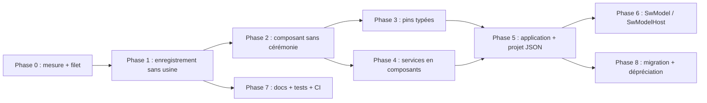

# StreamWork : plan de convergence vers l'esprit Nebula

Ce plan complète [PlanModernisation.md](PlanModernisation.md). Ce dernier traite la dette technique (C++14, Qt 6, JSON, LibIndeSig, Qst). Celui-ci traite l'**ergonomie pour l'auteur** : écrire moins de code pour faire un plugin, un composant ou une application.

## 1. Objectif et périmètre

Reprendre de Nebula **les idées**, pas le code :

- **Moins de code à écrire** : un composant ne touche plus à une fabrique, à une chaîne de `if` ni à un export C.
- **Plus simple à maintenir** : une seule source de vérité par information (nom, description, version, propriétés).
- **Plus simple à utiliser** : CMake en quelques lignes, documentation pas à pas, tests par classe.
- **Compatible** : les plugins `.swdl` existants et les streams XML continuent de fonctionner pendant la transition.

Contraintes héritées de StreamWork :

| Contrainte | Conséquence |
|---|---|
| C++14, Qt 5.15 | Nebula utilise C++20 (concepts, `std::derived_from`) et Qt 6. On garde l'idée avec `static_assert` + `std::is_base_of`/SFINAE. Aucun code Nebula n'est repris tel quel. |
| Framework déjà diffusé à plusieurs équipes | Aucune rupture brutale : ancienne et nouvelle API coexistent, avec dépréciation (voir section 9). |
| Vocabulaire existant (Stream, Pin, Component, Service) | Il est conservé. On ne reprend pas le vocabulaire Nebula (Galaxy, Astre…). |

## 2. Ce qui rend Nebula simple (et l'écart avec StreamWork)

| Sujet | StreamWork aujourd'hui | Nebula | Cible StreamWork |
|---|---|---|---|
| Enregistrer un composant | Classe usine par plugin (`_XxxPluginFactory_Class`, 2 fichiers). Le nom est écrit 3 fois : `RegisterComponent("X", "desc")`, `SW_PUBLISH_COMPONENT("X", X)` (chaîne de `if` dans `CreateInstanceOf`) et l'`#include`. À chaque ajout, on modifie l'usine. Exemple : `SwGui` a une cinquantaine de lignes `RegisterComponent`. | Une ligne dans le `.cpp` du composant : `NEBULA_REGISTER_COMPONENT(Plugin, Composant);` | `SW_REGISTER_COMPONENT(Plugin, Composant);` : l'usine disparaît. |
| Classe du plugin | Écrite à la main : `Initialize`, `Liberate`, `GetPluginVersion`, `GetPluginCompilationDate`, `CreateInstanceOf` ×2, `CreateIconOf`, export `GetPluginInterface`. | Générée par CMake à partir d'un gabarit ; l'auteur ne l'écrit pas. | Générée par `sw_add_plugin()`. |
| Métadonnées du plugin | Lues en chargeant la DLL. | Id, nom, version, version du cœur dans un JSON (`Q_PLUGIN_METADATA`), lues **sans charger**. Compatibilité contrôlée au scan. | Même principe : JSON embarqué par `Q_PLUGIN_METADATA` (disponible en Qt 5.15), lu au scan sans charger la DLL. |
| Description / catégorie d'un composant | Chaîne passée à `RegisterComponent`, loin de la classe. | `Q_CLASSINFO("description", …)` et `Q_CLASSINFO("category", …)` sur la classe. | Même principe : `Q_CLASSINFO("description", …)` et `Q_CLASSINFO("category", …)` sur la classe, plus de chaîne dans `RegisterComponent`. |
| CMake d'un plugin | `cstoolkit_add_target(… SHARED NAMESPACE Streamwork EXTENSION swdl RECURSIVE RECURSIVE_INCLUDE PUBLIC_LINK_LIBRARIES …)` avec 10 à 15 bibliothèques (ex. `SwGui`). | `nebula_add_plugin(NAME … DESCRIPTION … VERSION …)` : 3 lignes, sources trouvées automatiquement. | `sw_add_plugin(NAME … VERSION …)` avec liens par défaut (SwCore, SwFoundation, Qt5::Core, Qt5::Widgets). |
| Création de l'objet | Appel manuel de `initializeComponent()` puis `createPropertiesForThisObject()` par l'auteur. | `Plugin::Instance<T>` : le plugin crée l'objet et gère son cycle de vie. Propriétés `Q_PROPERTY` exposées d'office. | `SwPlugin::Instance<T>` appelle les étapes d'initialisation. L'auteur n'écrit plus `createPropertiesForThisObject()`. |
| Interfaces entre composants | `provideInterface<T>(nom, ptr)` existe déjà. Consommation par observateur. | `consumeInterface<T>(nom, membre, Mandatory, onAvailable, onUnavailable)` : le membre est écrit par le cœur. | Même signature de confort au-dessus de l'existant. |
| Données des pins | `SwData_Class` : UUID + `GetType` + `GetTypeId` + `InternalRead` + `InternalWrite` + `CreateInstance` + `RegisterData` dans l'usine. | Pas d'équivalent. Les interfaces sont typées par `QMetaType`. | Pins typées : `addInput<T>(nom, callback)` / `addOutput<T>(nom)`. Plus de `dynamic_cast` ni d'UUID à la main. |
| Services | Singletons enregistrés via `SW_APP->RegisterService`, accédés par `SwServiceManager_Helper<I>`. Un plugin usine par service. | Pas de singleton : un service est un composant qui fournit une interface (ex. `LogComponent` fournit `ILog`). | Voir phase 4. |
| Composition (galaxy / stargate) | `SwModel` : un stream enregistré comme modèle devient un composant (`_SwModel_Class`, qui expose `ISwSubStream`) ; `SwModelHost` (`_SwModelHost_Class`) l'accueille et expose ses entités (`_SwModelExported*` : propriétés, pins, interfaces, exécutables). Les modèles sont enregistrés **dynamiquement** par l'usine (`modelAdded`, `RereadPluginContent`) et lus en XML. | `Galaxy` : un projet `.nbp` inclus comme composant ; `Stargate` : ce qu'il expose. | `SwModel` est déjà l'équivalent : on le garde et on le simplifie (phase 6). |
| Application | `main.cpp` d'environ 60 lignes (`SW_APP`, chemins, `Launch`, `try/catch`). | `NebulaApplication` : options de ligne de commande et projet gérés. | `SwApplication` (phase 5). |
| Fichier projet | XML. | JSON versionné (`version`, `plugins`, `components`, `bindings`). | JSON : voir phase 5 de `PlanModernisation.md`. |
| Tests | Aucun. | Un exécutable Qt Test par classe, `ctest`, couverture 80 % imposée par la CI. | Voir phase 7. |
| Documentation | 7 fichiers `.md` à la racine qui se recoupent (`INDEX_COMPLET`, `RESUME_MISE_A_JOUR`, `QUICKSTART`…). | `README` de référence, wiki pas à pas, glossaire, `CONVENTIONS.md`, `CHANGELOG.md`, `CLAUDE.md` (carte du code). | Voir phase 7. |

## 3. Cible : ce que l'auteur écrit

### Composant (avant)

Usine du plugin, 2 fichiers :

```cpp
// _XxxPluginFactory_Class.cpp
void _XxxPluginFactory_Class::Initialize() {
    RegisterComponent("SwConfPushButton", "Declenche la sauvegarde de la conf");
}
SwComponent_Class* _XxxPluginFactory_Class::CreateInstanceOf(QString name) {
    SW_PUBLISH_COMPONENT("SwConfPushButton", SwConfPushButton);
    return NULL;
}
SwPluginFactory_Class* GetPluginInterface() { return new _XxxPluginFactory_Class(); }
```

Composant :

```cpp
void SwConfPushButton::initializeComponent() {
    createPropertiesForThisObject();
    createPropertiesForQObject(_pb, "QPushButton");
    provideInterface<QWidget>("Widget", _pb);
}
```

### Composant (cible)

Aucune usine. Un `.h`, un `.cpp` :

```cpp
// ConfPushButton.h
class ConfPushButton : public SwComponent {
    Q_OBJECT
    Q_CLASSINFO("description", "Declenche la sauvegarde de la conf")
    Q_CLASSINFO("category", "Configuration")
    Q_PROPERTY(QString confName READ confName WRITE setConfName NOTIFY confNameChanged)
public:
    ConfPushButton();
    // accesseurs et signal
private:
    QPushButton m_button;
    QString m_confName;
};

// ConfPushButton.cpp
SW_REGISTER_COMPONENT(ConfPlugin, ConfPushButton);

ConfPushButton::ConfPushButton() {
    provideInterface<QWidget>("widget", &m_button);
    addPropertiesForQObject(&m_button, "QPushButton");
}
```

### Plugin (cible)

```cmake
sw_add_plugin(
    NAME ConfPlugin
    DESCRIPTION "Composants de configuration"
    VERSION 1.0.0
)
```

### Application (cible)

```cpp
int main(int argc, char* argv[]) {
    StreamWork::SwApplication app(argc, argv);
    return app.run();   // options, chemins de plugins, stream, erreurs
}
```

### Objectifs chiffrés

| Mesure | Aujourd'hui | Cible |
|---|---|---|
| Fichiers à écrire pour un plugin d'un composant | 6 (usine ×2, composant ×2, CMake, export) | 3 (composant ×2, CMake) |
| Fichiers modifiés pour ajouter un composant à un plugin existant | 3 à 4 (composant ×2, usine ×2) | 2 |
| Lignes de CMake d'un plugin | 10 à 15 | 3 à 5 |
| Noms de composant à saisir | 3 | 0 (le nom de la classe) |
| Lignes d'un `main.cpp` | environ 60 | environ 5 |

Mesurer l'état initial en phase 0 pour que ces valeurs soient vérifiables.

## 4. Principes de conception

1. **Une seule source de vérité** : nom = nom de la classe, description et catégorie = `Q_CLASSINFO`, version = CMake.
2. **Le framework fait le câblage** : enregistrement, propriétés, cycle de vie, liaison des interfaces.
3. **Un contrat par composant** : interfaces et pins déclarées au constructeur, typées.
4. **Pas de singleton pour les fonctions de base** : un service est un composant qui fournit une interface.
5. **Compatibilité d'abord** : l'ancien mode reste actif tant que la période de dépréciation n'est pas terminée.
6. **Chaque étape est testée** avant d'être généralisée.

## 5. Phases

Les phases 0 et 1 de `PlanModernisation.md` (tests, CI, `nullptr`, `override`) sont des **prérequis**.

### Phase 0 : cadrage et mesure

1. Mesurer l'état initial : fichiers et lignes pour un plugin minimal, nombre de lignes `RegisterComponent`, `main.cpp` (tableau section 3).
2. Choisir un plugin pilote petit et représentatif (`SwServiceConfiguration` : 1 composant, 1 service) et un plus gros (`SwGui` : ~50 composants).
3. Décisions prises : voir section 10.
4. `test` : un test de chargement qui scanne un dossier de plugins, charge chaque `.swdl` et liste ses composants. Il servira de filet pour toutes les phases suivantes.

### Phase 1 : enregistrement sans usine (le gain le plus visible)

1. `feat(core)` : `SwPlugin<P>` (CRTP) tient la liste statique des composants de `P` et implémente la création par nom. Il remplace `CreateInstanceOf(QString)`.
2. `feat(core)` : `SW_REGISTER_COMPONENT(Plugin, Classe)`, initialisation statique qui s'ajoute à cette liste. `static_assert(std::is_base_of<SwComponent_Class, Classe>::value)`.
3. `feat(core)` : le nom enregistré est celui de la classe, sans espace de noms. Pour les composants existants, le nom historique est conservé par un alias facultatif (`SW_REGISTER_COMPONENT_AS(Plugin, Classe, "NomHistorique")`), car les streams XML en dépendent.
4. `feat(core)` : enregistrement dynamique, `addComponent(nom, description, créateur)` et `removeComponent(nom)`, notifié au gestionnaire de plugins (remplace `RereadPluginContent`). Les modèles de `SwModel` n'ont pas de classe C++ : ils s'enregistrent à l'exécution (phase 6).
5. `feat(core)` : lecture de la description et de la catégorie depuis `Q_CLASSINFO` (repli sur la chaîne de `RegisterComponent` s'il y en a une).
6. `feat(cmake)` : `sw_add_plugin()`, fournie par **cstoolkit** (conservé et mis à jour, plus complet que le `CMakeUtils` de Nebula) :
   - s'appuie sur `cstoolkit_add_target` (extension `swdl`, `RECURSIVE`, liens par défaut) ;
   - génère la classe du plugin (gabarit `.h.in`) avec `GetPluginInterface`, la version et la date de compilation ;
   - `cstoolkit_add_target` reste utilisable tel quel pour les projets existants.
7. `feat(core)` : métadonnées JSON du plugin (id, nom, version, version du cœur) lues sans charger la DLL (voir `SW_PLUGIN_API_VERSION` dans la phase 6 de `PlanModernisation.md`).
8. `feat(core)` : `_SwPluginsBank_Class` accepte les deux modes. Un `.swdl` qui exporte `GetPluginInterface` est chargé comme avant (**mode hérité**) ; un plugin généré est chargé par le nouveau chemin.
9. Pilote : migrer `SwServiceConfiguration`, puis un module à la fois (`SwRecord`, `SwDataBase`, `SwModel`, `SwConfiguration`, `SwExecution`, `SwEditor`, `SwGui`, services). Un commit par module.
10. `test` : mêmes composants listés avant et après, mêmes noms, mêmes descriptions.

Livrable : ajouter un composant revient à écrire deux fichiers.

### Phase 2 : composant sans cérémonie

1. `feat(core)` : `SwPlugin::Instance<T>` crée l'objet, puis appelle automatiquement l'initialisation. `createPropertiesForThisObject()` n'est plus à écrire (les `Q_PROPERTY` sont exposées d'office). `initializeComponent()` reste appelable pour compatibilité.
2. `feat(core)` : crochets de cycle de vie nommés `onStart()` / `onStop()` pour les composants non exécutables, alignés sur les méthodes actuelles (`Initialize`, `Start`, `Stop`). Aucun changement pour `ExecutableComponent`.
3. `feat(core)` : `Instance<T>` appelle `releaseInterfaces()` avant le destructeur de `T`, pour éviter les accès à des objets déjà détruits.
4. `feat(foundation)` : `addPropertiesForQObject(objet, nom)` en alias de `createPropertiesForQObject`. Les objets Qt de l'auteur sont des membres (pas de `new`/`delete`), détruits avec le composant.
5. `docs` : modèle de composant recommandé (nom `<Nom>Component`, objets créés dans le constructeur).
6. `refactor` : adapter les composants du pilote, puis ceux des modules, par commit mécanique.

### Phase 3 : pins et données typées

Objectif : supprimer la cérémonie des `SwData_Class` (6 méthodes virtuelles + UUID + `RegisterData`) et les `dynamic_cast` dans `eventReceiveData`.

1. `feat(core)` : `SwTypedData<T>` (T sérialisable par `QDataStream` ou `Q_DECLARE_METATYPE`). Il fournit tout seul `GetType`, `GetTypeId` (dérivé du nom de type), `InternalRead`, `InternalWrite`, `CreateInstance`.
2. `feat(core)` : `SW_REGISTER_DATA(Plugin, Type)` en remplacement de `RegisterData(UUID, nom)`. Les UUID existants sont conservés par un paramètre facultatif, car ils sont écrits dans les streams.
3. `feat(core)` : déclaration typée dans le constructeur :
   ```cpp
   addInput<QByteArray>("Input", [this](const QByteArray& d) { process(d); });
   m_out = &addOutput<QByteArray>("Output");
   m_out->send(result);
   ```
   Ces fonctions s'appuient sur `AddInputPin`, `AddOutputPin` et `enableListeningForPin` existants.
4. `feat(core)` : refus au moment de la connexion de deux pins de types incompatibles, avec un message clair.
5. Les anciennes classes `SwData_Class` et `eventReceiveData` restent en mode hérité ; elles sont marquées `[[deprecated]]` (C++14) en fin de période.
6. `refactor` : migrer `SwDataBase` en pilote (routeur générique), puis les types de données de `SwFoundation`.

### Phase 4 : services en composants

Les services ont un rôle de singleton global (`SW_APP->RegisterService`). Nebula les remplace par des composants qui fournissent une interface, ce qui les rend testables, remplaçables et visibles dans l'éditeur.

1. `feat(core)` : un composant fournisseur d'une interface de service s'enregistre dans le gestionnaire de services existant (le service reste accessible par `SwServiceManager_Helper<I>`). On ajoute la voie composant sans enlever l'ancienne.
2. `feat(core)` : `consumeInterface<T>(nom, membre, Mandatory|Optional, onAvailable, onUnavailable)` : le membre pointeur est écrit par le cœur ; le composant n'a plus à gérer `ISwServices_Listener`.
3. `refactor` : un service à la fois, du plus simple au plus utilisé : `SwServiceTools`, `SwServiceShortcut`, `SwServiceConfiguration`, `SwServiceMainWindow`. Chaque service garde son interface `ISwService*` (le contrat ne change pas).
4. `feat` : composants « standard » **livrés par défaut avec le framework sous forme de plugins** (`.swdl`), à la manière du `StandardPlugin` de Nebula : journal (`ILog`), historique annuler/refaire. Leurs interfaces sont dans une cible `Streamwork::Standard` (en-têtes seuls) que lie un plugin pour les consommer. Ils sont installés dans le dossier `plugins/` du paquet. Cela supprime les loggers multiples signalés dans la phase 2 de `PlanModernisation.md`.
5. `docs` : règle simple : un service est un composant ; un singleton n'est justifié que pour la gestion des plugins et le cœur.

### Phase 5 : application et projet

1. `feat(core)` : `SwApplication` (`QApplication` + options) : chemins de plugins, fichier de stream, `--version`, `--help`, `--log-file`, `--headless` pour les exécutions sans GUI (utile en CI et pour la phase 7 de l'ancien plan). Le code actuel de `SwLauncher/src/main.cpp` y est déplacé.
2. `refactor` : `SwLauncher/main.cpp` et `StreamWorkEditor` réduits à quelques lignes.
3. Aligner le fichier JSON de stream (phase 5 de `PlanModernisation.md`) sur la forme simple de Nebula :
   ```json
   {
     "format": "streamwork.stream",
     "version": 1,
     "plugins":    [ { "id": "...", "file": "plugins/X.swdl" } ],
     "components": [ { "name": "...", "type": "...", "properties": {} } ],
     "links":      [ { "from": "A.Output", "to": "B.Input" } ]
   }
   ```
   La lecture du XML est conservée. L'écriture bascule en JSON après accord de l'utilisateur.
4. `feat` : fichiers de réglages par composant (équivalent des « comets » de Nebula) : les valeurs propres à un poste ou à un utilisateur sont séparées du stream. S'appuie sur `.conf` existant.
5. `feat` : validation du stream au chargement : composant inconnu, pin inexistante, type incompatible, interface obligatoire non liée. Message qui nomme le composant fautif.

### Phase 6 : `SwModel` / `SwModelHost`, l'équivalent de la galaxy

StreamWork a déjà le concept : un stream devient un composant réutilisable (`SwModel`), posé dans un `SwModelHost` qui en expose une partie (`_SwModelExported*`). Il s'agit donc d'aligner `SwModel` sur l'ergonomie de `Galaxy` / `Stargate`, pas de créer une nouvelle notion.

Écarts avec Nebula à traiter :
- le plugin `SwModel` a la plus grosse usine à écrire à la main : enregistrement dynamique des modèles, chargement XML dans `CreateInstanceOf`, services (`SwModelsListAccess`) ;
- les modèles sont lus en XML (`QDomDocument`) et passent par `SwLoader_Class` ;
- les entités exportées sont déclarées via un éditeur dédié (`_SwModelHostExportSelector`, `_SwModelExportTreeView`) avec une famille de classes par type d'entité.

Étapes :
1. `feat(core)` : enregistrement **dynamique** dans `SwPlugin<P>` (`addComponent(nom, description, créateur)` / `removeComponent`). Les modèles en ont besoin, car la liste statique de `SW_REGISTER_COMPONENT` ne suffit pas. Cette étape se fait en phase 1.
2. `refactor` : sortir de `_SwModelPluginFactory_Class::CreateInstanceOf` le chargement d'un modèle vers une classe `SwModelLoader` testable, qui lit XML et JSON (via `SwArchive`, phase 5 de `PlanModernisation.md`). L'usine ne fait plus que l'appeler.
3. `feat` : fichier de modèle JSON qui déclare, en plus du stream, ses **entités exposées** (propriétés, pins, interfaces) sous la forme `exposed: [ { "name": …, "target": "Composant.élément" } ]`, comme les valeurs exposées d'une galaxy. L'édition passe par l'éditeur existant.
4. `refactor` : fusionner les classes `_SwModelExported*` autour d'une seule abstraction « entité exposée » (nom, cible, type) à la place d'une classe par type quand leur code est identique. Cela suit la liste de la phase 2 de `PlanModernisation.md`.
5. `feat` : un modèle est un composant comme les autres : son nom, sa description et sa catégorie viennent du fichier (`description`, `category`), comme `Q_CLASSINFO` pour les autres composants.
6. `feat` : validation au chargement (cible exposée introuvable, type incompatible) avec un message qui nomme le modèle.
7. `docs` : une page du wiki « Créer un modèle réutilisable » et un exemple.
8. `test` : charger un modèle, l'instancier dans un host, vérifier les entités exposées, enregistrer et relire (XML puis JSON).

### Phase 7 : documentation, tests, conventions

1. `docs` : consolider les fichiers racine (`INDEX_COMPLET`, `RESUME_MISE_A_JOUR`, `QUICKSTART`, `ARCHITECTURE_*`, `SPECIFICATION_*`, `GUIDE_*`, `SOLUTION_*`, `CHIFFRAGE_*`) :
   - `README.md` : référence de l'API ;
   - un dossier `Documentation/wiki/` pas à pas : *Premier plugin*, *Écrire un composant*, *Pins et données*, *Écrire un service*, *Assembler une application* ;
   - `GLOSSAIRE.md` : Stream, Component, Pin, Service, Plugin, Draw local/partagé ;
   - `CLAUDE.md` (ou `ARCHITECTURE.md`) : carte du code mise à jour à chaque changement d'architecture ;
   - `CONVENTIONS.md` : style (`.clang-format`), nommage, règles de commit ;
   - `CHANGELOG.md` : format Keep a Changelog.
   Les anciens documents sont archivés dans `Documentation/Archives/`, pas supprimés.
2. `docs` : un plugin d'exemple (`exemple/`) pour chaque page du wiki : un composant minimal, un composant avec pins, un service, une application.
3. `test` : un exécutable de test par classe du cœur (`SwPlugin`, `SwComponent`, pins typées, chargement de stream) lancé par `ctest` ; tests de plugin (chargement + création de chaque composant).
4. `ci` : `Jenkinsfile` : exécution de `ctest`, mesure de couverture, étape SonarQube avec seuil sur le nouveau code (80 %), analyse du paquet livré.
5. `ci` : paquet livré aux équipes : il contient les plugins standard, `sw_add_plugin()` (via cstoolkit), les gabarits et un `find_package(Streamwork)` suffisant pour compiler un plugin tiers.

### Phase 8 : migration des équipes et dépréciation

1. Guide de migration : tableau « ancien code / nouveau code » (usine, `SW_PUBLISH_COMPONENT`, `SwData_Class`, services).
2. Script qui génère les `SW_REGISTER_COMPONENT` depuis une usine existante (lecture des `RegisterComponent` et `SW_PUBLISH_COMPONENT`).
3. Marquer l'ancien mode `[[deprecated]]` avec message vers le guide.
4. Suppression de l'ancien mode à la version majeure suivante (voir calendrier de `PlanModernisation.md`).

## 6. Compatibilité

| Élément | Règle |
|---|---|
| Plugin `.swdl` hérité | Chargé tel quel (mode hérité) jusqu'à la version majeure suivante. |
| Noms de composants dans les streams | Inchangés ; alias historique obligatoire si le nom de classe diffère. |
| UUID des données | Inchangés ; passés en paramètre de `SW_REGISTER_DATA` si présents dans les streams. |
| Interfaces `ISwService*` | Inchangées. |
| Stream XML | Toujours lu. Conversion JSON proposée. |
| ABI | Change à la version majeure : les tiers recompilent. |

## 7. Ordre et dépendances



Phase 7 (tests et documentation) commence dès la phase 1 et suit chaque phase : on ne livre pas une API sans sa page de wiki ni son test.

Intégration avec `PlanModernisation.md` : les phases 3 (signaux) et 6 (Qst) peuvent avancer en parallèle de la phase 1 ; la phase 5 (JSON) est commune ; la phase 4 de ce plan profite de la suppression de `LibIndeSig`.

## 8. Risques

| Risque | Parade |
|---|---|
| Initialisation statique avant `QCoreApplication` (liste de composants) | Liste statique locale à `P` (construction à la première utilisation), pas de dépendance à Qt dans l'enregistrement. |
| Ordre d'initialisation entre DLL | Chaque plugin a sa propre liste ; le gestionnaire la lit après chargement. |
| Noms de composants changés par inadvertance | Test de non-régression sur la liste des noms (phase 0). |
| Le mode hérité complexifie le cœur | Isoler l'ancien chemin dans une seule classe (`LegacyPluginAdapter`), supprimée à la version majeure suivante. |
| Équipes tierces qui ne migrent pas | Guide, script de conversion, période de dépréciation annoncée, un référent par équipe. |
| `Q_PROPERTY` exposées d'office qui montrent des propriétés qui ne devaient pas l'être | Respecter `DESIGNABLE false` / `STORED false` ; liste des cas à revoir en phase 2. |

## 9. Livraison

- Versions intermédiaires : chaque phase peut être livrée en version mineure (ajout seulement, ancien mode actif).
- Version majeure : retrait du mode hérité, bascule JSON par défaut.
- Chaque commit compile, passe les tests, et ne mélange pas changement mécanique et fonctionnel (règles de `PlanModernisation.md`, section 3).

## 10. Décisions

### Prises

| Question | Décision |
|---|---|
| Faire évoluer StreamWork ou adopter Nebula | **StreamWork est modernisé.** Nebula n'est pas utilisé comme base ni comme dépendance : ses idées seulement. |
| Nom des macros et fonctions | `SW_REGISTER_COMPONENT`, `SW_REGISTER_COMPONENT_AS`, `SW_REGISTER_DATA`, `sw_add_plugin`, `SwPlugin<P>`, `SwApplication` : retenus. |
| Outil de build | **cstoolkit est conservé** et mis à jour. Le `CMakeUtils` de Nebula n'est pas adopté. |
| Composants standard (journal, historique) | **Plugins livrés par défaut** avec le framework (phase 4, étape 4). |
| Phase 6 (`SwModel` / `SwModelHost`) | Aligner sur la galaxy : le concept existe et sert déjà, seule la mise en œuvre (usine, XML, entités exportées) est lourde. |

### Restent à trancher

| Question | Options |
|---|---|
| Contenu des plugins standard au premier livrable | Journal seul, ou journal + historique. |

## 11. Critères de réussite

- Plugin minimal : 3 fichiers, un `CMakeLists.txt` de 5 lignes au plus.
- Ajout d'un composant : 2 fichiers, aucun autre fichier modifié.
- `main.cpp` d'une application : environ 5 lignes.
- Tous les plugins du dépôt migrés ; les streams de référence (phase 0) se chargent à l'identique.
- Un nouvel arrivant écrit son premier composant en suivant uniquement le wiki.
- Couverture de tests de 80 % sur le nouveau code.
